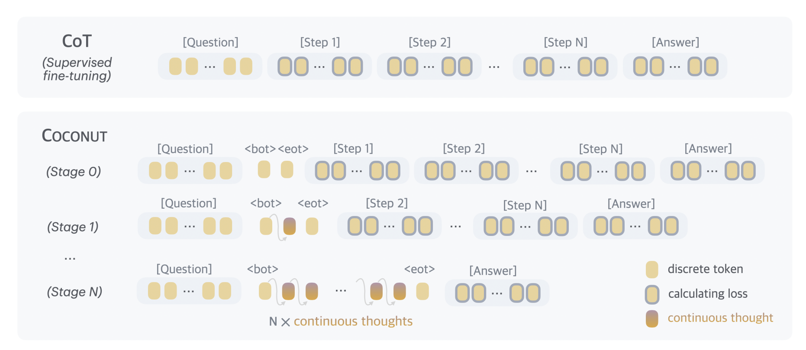

# COCONUT 학습과 Stage Curriculum

이 프로젝트의 학습은 Qwen3-VL에 KRAdapter를 적용하고, COCONUT(continuous thought) curriculum을 stage별로 수행합니다. 실행 진입점은 `train/run.sh`이며 내부적으로 `torchrun -m train.coconut`을 호출합니다.

설정 키의 개별 의미는 [Train Configure Setting](train_config.md)을 참고합니다. 이 문서는 **학습이 진행되는 순서와 stage 실행 방법**을 설명합니다.

## 학습 처리 흐름

```text
학습 YAML + Qwen YAML
        │
        ├─ Qwen3-VL / processor 로드
        ├─ KRAdapter 적용, base model·vision encoder 고정
        ├─ COCONUT marker token 추가
        ├─ 이미지·질문·reasoning 데이터를 token화
        ├─ 현재 stage에 맞게 reasoning 일부를 latent slot으로 치환
        └─ Hugging Face Trainer로 학습하고 epoch마다 checkpoint 저장
```

## Stage별 학습 방식



COCONUT은 reasoning을 통째로 출력하게 하는 대신, 앞부분의 reasoning step을 연속 latent token으로 교체해 모델 내부의 hidden state로 사고하도록 학습합니다.

| stage | 입력 뒤에 넣는 latent marker | 정답으로 학습하는 부분 |
| --- | --- | --- |
| 0 | 없음 | `original_answer` 전체 |
| N (N ≥ 1) | <\|start-latent\|> + `N` × c_thought개의 <\|latent\|> + <\|end-latent\|> | N개를 제외한 남은 reasoning step과 `answer` |

예를 들어 `c_thought: 2`인 stage 2는 첫 두 reasoning step을 총 4개의 latent slot으로 바꾸고, 세 번째 step부터 최종 답변까지를 supervision target으로 둡니다. `c_thought`는 stage 1 이상에서 반드시 1 이상이어야 합니다.

`max_latent_stage`는 실행 가능한 최종 stage 번호입니다. 새 run은 항상 stage 0에서 시작하며, checkpoint를 불러왔을 때만 checkpoint의 완료 상태를 기준으로 다음 stage 또는 미완료 stage를 결정합니다.

## 제공된 stage config 실행

현재 제공된 설정은 `stage0 → stage1 → stage2` 순서로 연결되어 있습니다.

| config | checkpoint 입력 | checkpoint 출력 | 학습 특징 |
| --- | --- | --- | --- |
| `config/stage/0.yaml` | 없음 | `history/stage0` | 일반 SFT, `c_thought: 0` |
| `config/stage/1.yaml` | `history/stage0` | `history/stage1` | 첫 reasoning step을 latent slot으로 교체 |
| `config/stage/2.yaml` | `history/stage1` | `history/stage2` | 첫 두 reasoning step을 latent slot으로 교체 |

저장소 루트에서 다음 순서로 실행합니다.

```bash
# 1. stage 0: 새 run 시작
bash train/run.sh \
  --model-config config/qwen.yaml \
  --train-config config/stage/0.yaml \
  --device cuda:0

# 2. stage 1: history/stage0을 이어받음
bash train/run.sh \
  --model-config config/qwen.yaml \
  --train-config config/stage/1.yaml \
  --device cuda:0

# 3. stage 2: history/stage1을 이어받음
bash train/run.sh \
  --model-config config/qwen.yaml \
  --train-config config/stage/2.yaml \
  --device cuda:0
```

stage 3 이상을 진행하려면 `stage/2.yaml`을 복사해 새 config를 만들고, `history.load_checkpoint`를 `stage2`, `history.save_name`을 새 run 이름으로 바꿉니다. `c_thought`는 양수로 유지하고 `max_latent_stage`도 목표 stage 이상이어야 합니다.

## 중단한 학습 재개

각 epoch가 끝날 때 checkpoint가 저장됩니다. 한 stage가 완전히 끝나면 `metadata.json`에 완료 stage가 기록됩니다.

- **미완료 stage를 재개**: 같은 stage config와 같은 run 이름을 사용합니다. `history.load_checkpoint`에 해당 run 이름을 넣거나 실행 시 `--load-checkpoint`로 지정합니다. 모델과 optimizer state를 모두 복원해 남은 epoch을 이어서 학습합니다.
- **완료된 stage 다음으로 진행**: 다음 stage config가 이전 run을 `history.load_checkpoint`로 가리키게 합니다. 모델 가중치는 복원하지만 optimizer는 새로 초기화합니다.

예를 들어 stage 1이 중단됐다면 다음처럼 명시적으로 재개할 수 있습니다.

```bash
bash train/run.sh \
  --model-config config/qwen.yaml \
  --train-config config/stage/1.yaml \
  --load-checkpoint stage1 \
  --device cuda:0
```

`--load-checkpoint`과 `--save-name`은 YAML의 `history.load_checkpoint`, `history.save_name`을 일회성으로 덮어씁니다. checkpoint 파일 경로도 지정할 수 있으며, run 이름은 `history_dir` 기준으로 해석됩니다.

## 저장 파일

run 디렉터리(`history/<save_name>/`)에는 다음이 생성됩니다.

| 파일 | 내용 |
| --- | --- |
| `train.yaml` | 실행에 사용한 학습 YAML 원본 사본 |
| `qwen.yaml` | 실행에 사용한 Qwen YAML 사본 |
| `checkpoint_stageXX_epochXXXX.pt` | 모델 상태, optimizer 상태, stage/epoch/global step, metric |
| `best.pt` | validation이 있으면 가장 낮은 validation loss checkpoint입니다. validation이 없으면 현재 callback에서는 저장된 epoch checkpoint를 best로 취급합니다. |
| `metadata.json` | 최신 checkpoint 및 마지막 완료 stage 정보 |
| `trainer_stageXX/` | 해당 stage의 Hugging Face Trainer 출력 디렉터리 |


## GPU 실행

`--device cuda:0`은 GPU 0만 보이도록 설정한 단일 GPU 실행입니다. 다른 GPU는 `cuda:1`처럼 지정합니다. 여러 GPU를 사용할 때는 `CUDA_VISIBLE_DEVICES`와 `NPROC_PER_NODE`를 함께 지정하고 `--device cuda`로 환경을 유지합니다.

```bash
CUDA_VISIBLE_DEVICES=0,1 NPROC_PER_NODE=2 \
  bash train/run.sh \
  --model-config config/qwen.yaml \
  --train-config config/stage/0.yaml \
  --device cuda
```

GPU 수를 늘려도 `batch_size`는 GPU당 micro-batch 크기입니다. 전역 유효 배치 크기는 대략 `batch_size × gradient_accumulation_steps × GPU 수`이므로, GPU 수를 바꾸면 학습률과 accumulation 설정을 함께 점검해야 합니다.

## 실행 전 점검

- `config/qwen.yaml`의 `image.min_pixels`, `image.max_pixels`가 VRAM에 맞는지 확인합니다.
- stage 1 이상은 `steps`가 있는 데이터와 양수 `c_thought`가 필요합니다.
- 새 실험은 기존 `stage0`을 덮어쓰지 않도록 각 stage YAML의 `history.save_name`을 고유한 이름으로 바꿉니다.
- stage config의 `history.load_checkpoint`가 바로 이전 run 이름을 가리키는지 확인합니다.
